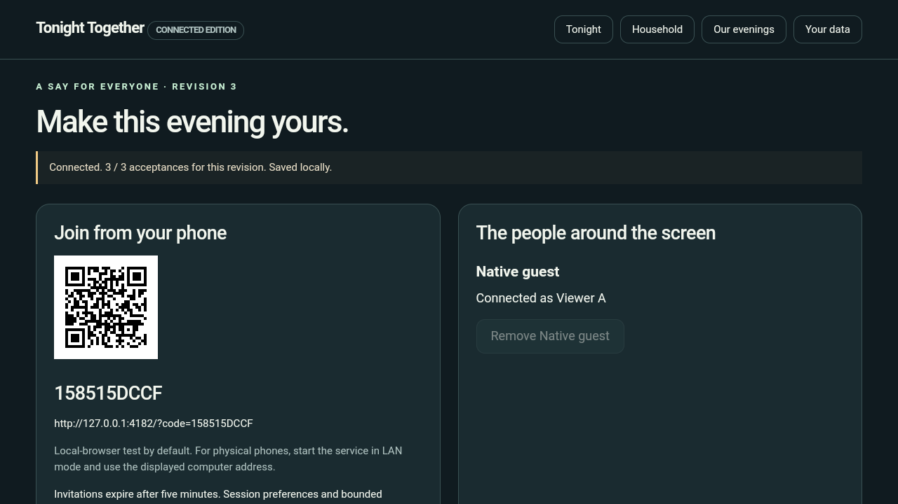
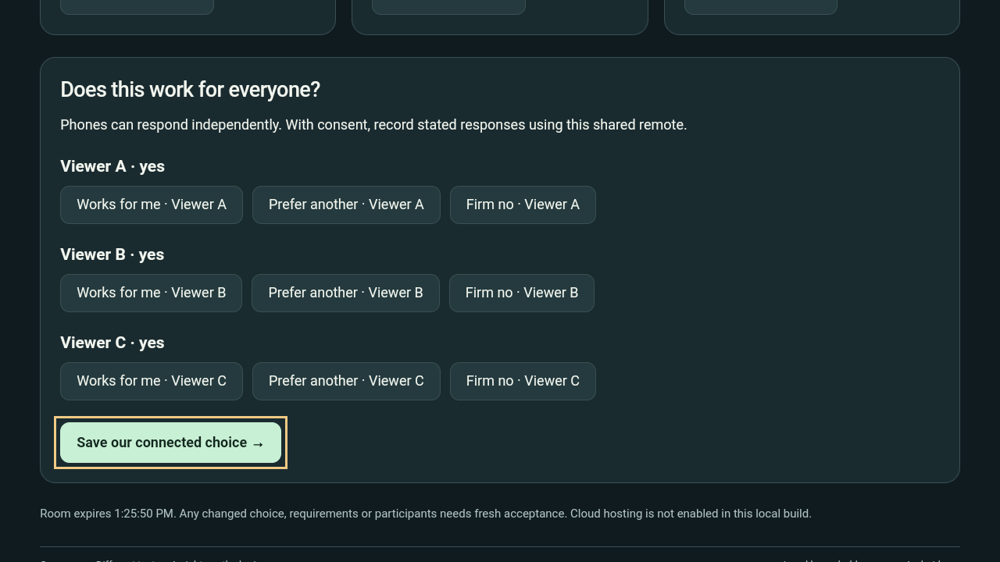
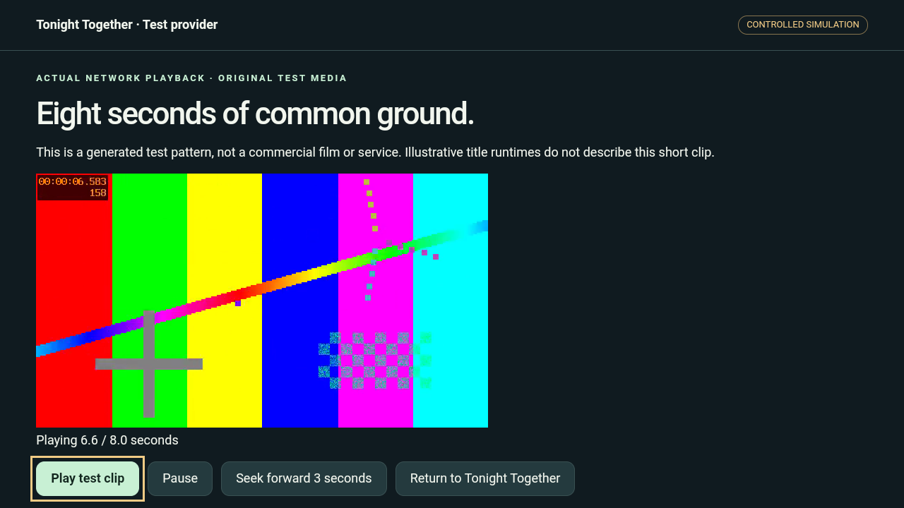
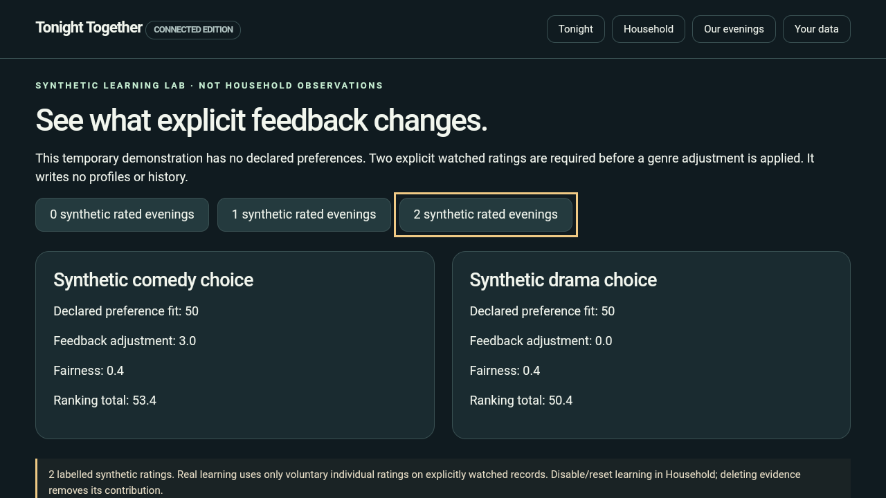

> **Official walkthrough completed — 22 October:** Watch the narrated 2:29.6 demo (kept locally), with approved ElevenLabs Sarah narration and English subtitles. [Verification and production details](docs/official-demo/PRODUCTION_STATUS.md). Public upload remains pending.

> **21 October presentation update:** Final visual improvements and labelled fictional programme names are implemented. [Current verification](docs/FINAL_IMPROVEMENTS_VERIFICATION.md) records 31 tests, browser/connected checks and native playback. Five separate submission PNGs (kept locally) are saved for manual upload. The official narrated walkthrough is now exported; evaluation-package reinstall smoke remains pending. Earlier screenshots/video below are historical.

> **Milestone 2 — connected local evaluation candidate.** Participant sessions, active negotiation, bounded feedback learning and controlled test streaming are implemented. Read [verified status](PROJECT_STATUS.md) and [setup](docs/MILESTONE_2_RUNBOOK.md). The original sibling project remains the preserved fallback.
# Tonight Together

**One screen. Different tastes. A night worth sharing.**

Tonight Together is a Fire TV household viewing companion designed to help families, partners, and housemates find something they can enjoy together—with understandable compromises and a say for everyone watching.

> Spend the evening together. Make choosing part of the pleasure.

*Version 0.1.0: local Android TV evaluation build, with offline consensus, persistent household memory and verified failure recovery. See the verification report for device coverage and release limits.*

## The evening we want to give back

Everyone has finally sat down. Someone wants a comedy. Someone else wants something absorbing. One person has only an hour. Another has a firm “anything but that.” The remote moves from hand to hand, suggestions meet objections, and the evening starts to disappear into the decision.

This illustrative scene captures the moment Tonight Together is designed for: people have made time for each other, but their preferences pull in different directions.

Our ambition is simple: **help a household arrive at a choice people understand and willingly accept, while preserving the joy of watching together.** A good result should make room for the person who usually gives way, respect a firm boundary, and explain why this particular choice could work tonight.

## The pain behind the idea

The research gave us three reasons to take this moment seriously:

- **Finding something to watch can consume time meant for watching.** In its October 2022 account of developing conversational Fire TV discovery, Amazon describes the difficulty of navigating content across services and the effort customers spend finding a programme. This is historical evidence of discovery friction, rather than a measurement of households in 2026. [Amazon Science: the “What Should I Watch?” experience](https://www.amazon.science/latest-news/the-science-behind-the-new-alexa-what-should-i-watch-fire-tv-experience).
- **Watching together changes the recommendation problem.** A 2014 study published through Microsoft Research examined more than four million logged household views to explore how individual preferences change when people watch with others. It provides a research basis for treating the group as a distinct viewing context. [A Large-scale Exploration of Group Viewing Patterns](https://www.microsoft.com/en-us/research/publication/large-scale-exploration-group-viewing-patterns/).
- **Household preferences can become fragmented across apps.** In a 2021 Fire TV discussion, a viewer described having separate family profiles yet still encountering another member's recommendations or the last-used streaming-app profile. It is a concrete account of family friction, not a current compatibility audit or a representative survey. [Fire TV community: family profiles across streaming services](https://www.reddit.com/r/fireTV/comments/o3cq55/link_firetv_profiles_to_netflix_mycanal_plex_or/).

Together, these sources informed our product question: **How can the people in the room make a shared choice without losing anyone's preferences along the way?** They support the problem context; testing with households must establish whether Tonight Together delivers the benefit we intend.

## Why we chose this solution

Our early exploration considered a broader personalised viewing companion, including conversational questions about titles and a richer archive. The research helped us sharpen the purpose.

Amazon's 2022 account already describes personalised recommendations, conversational filters, and questions about programmes. That made general discovery an important point of overlap. We chose to concentrate on the household decision: who is here, what matters tonight, where the preferences conflict, and which compromise everyone can accept. [Amazon Science: conversational Fire TV discovery](https://www.amazon.science/latest-news/the-science-behind-the-new-alexa-what-should-i-watch-fire-tv-experience).

That decision shaped the experience:

| What matters to the household | How Tonight Together is designed to respond |
| --- | --- |
| “Does this work for all of us?” | Compare individual fit as well as group fit, making weaker matches visible. |
| “Please respect my firm no.” | Apply explicit exclusions before ranking; changing a boundary requires a deliberate choice. |
| “Why this one?” | Explain the preferences it matches and the compromises it asks people to make. |
| “We still disagree.” | Offer comparison, alternatives, or a revision to tonight's setup; preserve everyone's boundaries. |
| “I always end up giving way.” | Include a small, visible fairness adjustment based on previous explicitly recorded watched sessions. |
| “Can we keep this simple?” | Use short choices, a small shortlist, and the television remote throughout the core journey. |

The implemented ranking uses transparent local rules. Explanations follow the actual decision factors. Explicit watched ratings can add a small, inspectable learning adjustment; firm exclusions still run first. The core experience works without a remote model. Saved household memory remains local; inviting participants shares the necessary session preferences and bounded fit summaries with the local room service. Raw reflection notes stay on the television.

## A night with Tonight Together

1. **Gather your people.** Select who is watching from a household whose preferences can be inspected and changed.
2. **Set the moment.** Choose a mood, available time, language needs, and any firm exclusions.
3. **Find common ground.** Explore a few suggestions with individual fit, group fit, and clear tradeoffs. Compare two when the choice is close.
4. **Give everyone a voice.** Join through a QR/link, receive host approval and respond independently, or use the television remote. A changed candidate or preference clears earlier acceptance. A firm no leads to a fresh choice.
5. **Resolve the obstacle.** Consider a specific, explained adjustment to tonight's time or mood. Confirm it deliberately; firm boundaries remain protected.
6. **Carry the choice forward.** Save unanimous agreement, open our clearly labelled test streaming provider, play a real clip and return to the same evening. Choosing and watching remain separate actions.
7. **Let evenings teach you.** Record explicit watched feedback, inspect its bounded influence and reset or disable learning whenever you want.

An illustrative explanation might read:

> “Fits your 90-minute limit and both viewers' comedy preference. It is less of a match for one viewer's preferred mood.”

That is the kind of honesty we want in the interface: a useful reason, a visible tradeoff, and room for people to decide.

## Built around the shared screen

Fire TV puts the decision where the household is gathered. Tonight Together is designed for readable cards, visible focus, predictable directional navigation, and short interactions that keep the conversation in the room.

The catalogue has documented sources and usage rights. Commercial viewing histories and live availability are not connected. Playback uses an original test clip through our own controlled provider, visibly labelled as a simulation. Household exclusions support decision-making; they do not certify age suitability or replace parental controls. Phone sessions use temporary capabilities and host approval, not verified personal identity. Shared-remote responses represent the group's stated choices.

Our success measures will include reaching an acceptable choice, understanding the compromise, feeling represented, and wanting to use the app again. Faster decisions are an intended benefit; measured time savings and household validation are not yet claimed.

## Explore the project

- [Developer friction log](HACKATHON_FRICTION_LOG.md) — concrete emulator, inspection and capture observations with workarounds, evidence and suggested improvements.

- [Architecture visuals](Architecture%20Diagrams/README.md) — household decision flow and implemented technical architecture, with upload-ready PNGs and editable SVGs.

- [Development status](PROJECT_STATUS.md) — verified achievements, incomplete features, and next delivery milestones.
- [Product requirements](Tonight_Together_PRD.md) — the complete experience, ranking proposal, screens, data controls, quality targets, and acceptance criteria.
- [Platform validation and delivery checklist](PLATFORM_VALIDATION_AND_DELIVERY.md) — target-runtime proof, implementation stages, testing, and submission readiness.
- [Selected concept: Fire TV Household Consensus](docs/PRODUCT_DECISIONS.md) — the research-backed direction that refined the earlier companion proposals.
- [Official demo script and female voice direction](docs/official-demo/OFFICIAL_DEMO_SCRIPT.md) — a 2:45 production draft; [rules/reference analysis](docs/official-demo/RESEARCH_RULES_AND_REFERENCE.md) records current requirements and sponsor/branding decisions. The final narrated video is now exported and verified (kept locally).

**Connected edition — 21 October 2026:** This independent Milestone 2 adds participant sessions, revision-safe negotiation, bounded feedback learning and an actual HTTP test-media handoff. The original application remains preserved as the fallback. See [Milestone 2 verification](docs/MILESTONE_2_VERIFICATION.md), [architecture](docs/MILESTONE_2_ARCHITECTURE.md) and the governing [second PRD](Tonight_Together_Milestone_2_PRD.md).

## Tested, with evidence

| Verification | Recorded result |
| --- | --- |
| Domain, storage and HTTP suite | 31 tests passed; see final improvements verification |
| Baseline browser journey | 17 scenario groups passed; zero script errors or unexpected requests |
| Directional navigation | 20 screens/states checked, including connected agreement and learning |
| Independent participation | Three participant browser sessions; approval, revisions, rejection, reconnect and unanimous save verified |
| Native Android TV Emulator | Actual provider playback, D-pad controls, Back return, missing-provider recovery and cold-restart persistence verified |
| Evaluation packages | Both non-debuggable APKs installed; actual playback and return smoke passed; signatures and packaged assets checked |

The [detailed verification report](docs/MILESTONE_2_VERIFICATION.md) maps all twelve Milestone 2 acceptance criteria to observed results, test methods, screenshots, artifact hashes and limitations. The [runbook](docs/MILESTONE_2_RUNBOOK.md) explains how to reproduce the local setup. Automated checks are under tests/ and scripts/qa/; the 105-second silent emulator walkthrough is at build/demo/tonight-together-m2-walkthrough.mp4. Build output is ignored and needs separate hosting for online reviewers.

**Delivery decision — 21 October 2026:** AWS is excluded from this submission candidate. The app is evaluated locally on Android TV Emulator with laptop-hosted room/media services. This does not claim physical Fire TV or physical-phone testing, commercial streaming compatibility, or measured household benefits. Cloud/Bedrock ideas remain future possibilities, not incomplete submission requirements.

## Emulator screenshots

Actual Android TV emulator screenshots using neutral demonstration households:









## Try Tonight Together

```powershell
npm test
npm run dev
```

The browser preview opens at `http://127.0.0.1:4181`. Start the optional room and test-provider services with `scripts/Start-Local-Services.ps1`. Follow the [Milestone 2 runbook](docs/MILESTONE_2_RUNBOOK.md) for both APKs, emulator port forwarding and participant setup. Local testing needs no AWS account and no runtime npm dependency. Physical phones require the documented LAN setup; the default QR is a loopback browser-test link.

Choose **Create your household** for 24 real sourced film records, or **Try the sample household** for a clearly labelled, reproducible consensus demo. The catalogue contains metadata, not films or streaming rights. [Catalogue sources and boundaries](CATALOGUE_SOURCES.md).

The target is **Fire OS**; Android TV Emulator is the verified development environment. Physical-device coverage, household usability outcomes and Appstore certification remain unproven. Publication/submission is separate from the completed local implementation.


## Run this repository

This repository contains the selected connected edition (Milestone 2), under the Tonight Together product name. The preserved fallback checkout is separate and is not needed to run this code.

Use Node.js 22 or later. The browser and local services have no npm runtime dependencies:

```powershell
npm test
npm run dev
```

In two additional terminals in the same directory, run `npm run rooms` and `npm run provider`. Open http://127.0.0.1:4181 for the host; participant pages use port4182, and the signed controlled-provider path uses port4183. Use the labelled sample household for a reproducible evaluation. See [the complete runbook](docs/MILESTONE_2_RUNBOOK.md) for invitations, agreement, playback and recovery.

For native evaluation, use the runbook's Android build/install/ADB-reverse steps. Build scripts assume a Windows Android SDK, build-tools35.0.0, platform35 and Android Studio's JBR; adjust the documented tool paths for your machine. Use your own development signing key generated by the build script. No private key, local household state or prebuilt APK is committed. The original test MP4 and required source/assets are included.

**Hosting decision — 22 October:** The owner chose to skip Vercel. This is an installable TV app with a documented local evaluation setup. A public website is not deployed. The final narrated MP4 is included as an asset; the owner still needs its public YouTube/Vimeo URL for the submission form. Repository and hosting record (kept locally).

**Source publication — 22 October:** Published to [TonightTogetherFireTV-V1](https://github.com/PetersonnOne/TonightTogetherFireTV-V1), branch main. Anonymous access is unavailable; if the repository stays private, the owner must grant the official reviewers access as described in the [hackathon FAQ](https://amazonappdev2026.devpost.com/details/faqs). Repository visibility was preserved. No website deployment or final submission is claimed.

**Repository contents — 23 October:** Submission Screenshots, Submission Video and Submit Project are kept locally and excluded from the tracked source tree, along with their screenshot ZIP. The standalone [hackathon friction log](HACKATHON_FRICTION_LOG.md) remains part of this repository.
